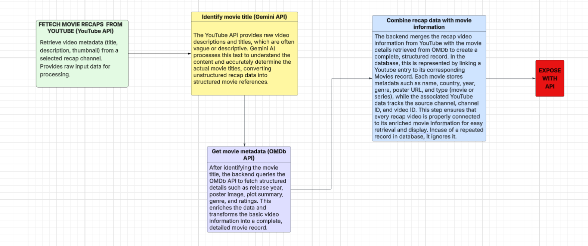

# 🎬 RECAPPED

**RECAPPED** is a web platform that helps users discover *high-quality movie recaps* without clickbait, misleading thumbnails, or endless trial-and-error.

---

## 🚀 Elevator Pitch

A curated movie-recap platform that lets users explore, filter, and watch YouTube movie recaps with full context—before committing their time.

---

## 🎥 Visuals (to be done next)

  <!-- Main user flow GIF here -->

---

## 📖 About The Project

### The Problem

Movie recap lovers face a surprisingly frustrating experience:

- YouTube offers **no reliable way** to judge recap quality beyond view counts  
- Thumbnails and titles are often **clickbait or AI-generated**
- Viewers lack essential context like:
  - Country of origin  
  - Genre  
  - Release year  
- Finding a *satisfying recap* often means jumping from video to video

I found myself constantly abandoning recaps halfway through—not because the movies were bad, but because the **discovery process was broken**.

---

### The Solution

**RECAPPED** fixes this by turning movie recaps into **structured, searchable content**.

Instead of chasing random videos, users can:
- Browse a clean movie list with posters and ratings
- Filter movies by **year, country, and genre**
- Choose between **multiple recap sources** for the same movie
- Watch recaps directly inside the platform
- Rate movies to help future users

RECAPPED puts context firstso users know exactly what they’re about to watch.

---

## 🛠 Built With
**Frontend**
-    React
-   
- 🎥 React YouTube Player
- 🎨 Modern UI 

**Backend**

-  Django
- 🔧 Django REST Framework (DRF)
- 🔐 JWT Authentication

**APIs & Services**
- 📺 YouTube Data API (recap discovery)
- 🧠 Google Gemini (movie title extraction)
- 🎞 OMDb API (movie metadata & posters)

**Infrastructure**
- 
  Docker
-  PostgreSQL(image)
---

## ✨ Key Features

- ✅ User authentication with **JWT**
- ✅ Paginated movie listing with posters & ratings
- ✅ Advanced filters:
  - Year  
  - Country  
  - Genre
- ✅ Embedded YouTube recaps using React
- ✅ Multiple recap sources per movie
- ✅ User ratings (1–5 stars)
- ✅ Clean REST API built with DRF
- ✅ Fully containerized with Docker

---

## 🧠 How It Works (High Level)

1. Fetches movie recap videos from selected YouTube channels  
2. Uses **Gemini AI** to extract accurate movie titles from video metadata  
   - Only trusted channels are used to avoid hallucinations  
3. Sends the movie title to **OMDb API** for:
   - Poster  
   - Genre  
   - Country  
   - Release year  
4. Stores structured data in a relational database  
5. Exposes everything via a REST API consumed by React

  

---

