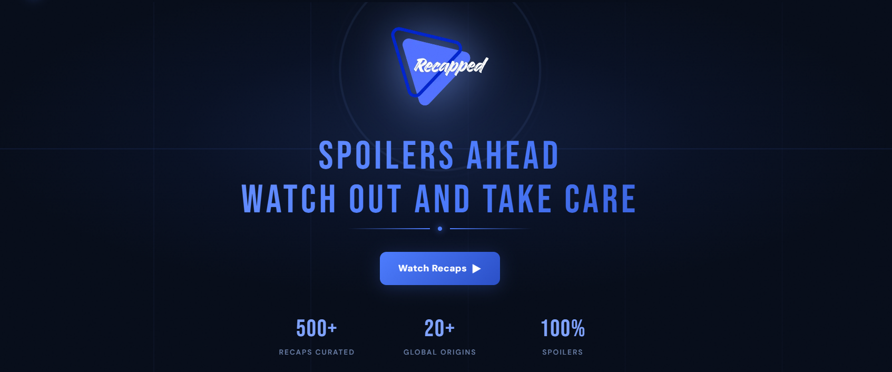
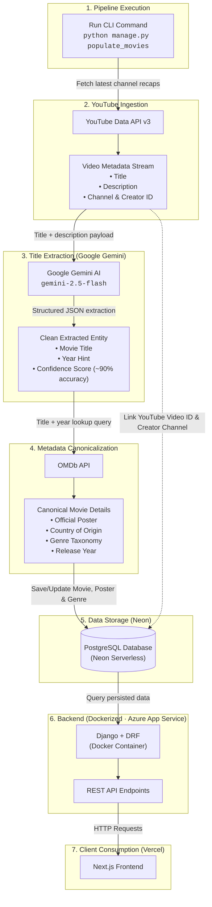

# RECAPPED

🌐 **Live:** [recapped-delta.vercel.app](https://recapped-delta.vercel.app/)

**RECAPPED** is a curated web platform designed to help movie lovers discover _high-quality movie and TV recaps_ without clickbait, misleading thumbnails, or endless trial-and-error.

  

Finding a great movie recap on YouTube often feels broken: clickbait titles, AI-generated thumbnail spam, missing release years, and zero context about genre or country of origin. **RECAPPED** transforms fragmented recap videos into a structured, searchable catalog enriched with verified movie metadata, posters, and multiple creator sources.

## About The Project

### The Problem

Movie recap enthusiasts face a frustrating experience:

- **No quality signals**: YouTube offers view counts and clickbait metrics, but no objective quality indicators.
- **Vague & clickbait titles**: Recap channels frequently obscure the real movie title (e.g., _"Man Gets Stuck In Bunker For 20 Years..."_).
- **Missing context**: Viewers have no easy way to know the movie's genre, release year, or country of origin before watching.
- **Fragmented discovery**: Finding a satisfying recap often means clicking back and forth across dozens of videos.

### The Solution

**RECAPPED** bridges YouTube creators and canonical movie data:

- **Accurate Movie Identification**: AI extracts actual movie titles from creative recap video descriptions with ~90% accuracy.
- **Rich Movie Metadata**: Full canonical context via OMDb (posters, genres, production countries, and release years).
- **Multiple Creator Perspectives**: Compare different recap creators for the exact same film.
- **Seamless Viewing**: Embedded playback directly within a sleek, modern Next.js interface.
- **Community Ratings**: Rate recaps and movies to help fellow viewers find the best content.

---

## Built With

### Frontend

- **Framework**: [Next.js](https://nextjs.org/) (App Router, React 19)
- **Language**: TypeScript
- **Styling**: Tailwind CSS (v4)
- **Networking**: Native Fetch API _(no Axios)_
- **Icons & UI**: Lucide React
- **Video Playback**: Embedded React YouTube Player

### Backend

- **Framework**: [Django](https://www.djangoproject.com/) & [Django REST Framework (DRF)](https://www.django-rest-framework.org/)
- **Authentication**: Simple JWT
- **Neon (Serverless PostgreSQL)**: Managed cloud database powering the production backend
- **Data Ingestion**: Custom Django management commands with multi-key API failover

### External APIs & AI

- **YouTube Data API v3**: Ingests recap video streams, descriptions, and channel creator details.
- **Google Gemini AI (`gemini-2.5-flash`)**: Extracts exact movie titles and release year hints with high precision (~90% accuracy).
- **OMDb API**: Enriches candidates with official posters, production country, and genre metadata.

### Infrastructure & DevOps

- **Docker & Docker Compose**: Unified multi-container orchestration (Django backend, Next.js frontend).
- **Azure Container Registry / Azure App Service**: The Django backend image is built and deployed on Azure.
- **Vercel**: Hosts the Next.js frontend.

---

## Key Features

- **JWT Authentication**: Secure user registration, login, and session tokens.
- **Paginated Discovery Catalog**: Fast, responsive grid with posters, release years, and origins.
- **Multi-Dimensional Filters**: Filter by **Year**, **Country of Origin**, and **Genre**.
- **Multi-Source Recaps**: Watch different YouTube creators' takes on the same movie in one unified view.
- **User Ratings System**: Interactive 1–5 star ratings.
- **Lightweight Networking**: Pure native `fetch` client integration (zero Axios overhead).
- **Automated Data Pipeline**: One-command ingestion and enrichment pipeline using Gemini + OMDb.

---

## Data Flow & Ingestion Pipeline

The automated ingestion pipeline turns unstructured YouTube recap videos into verified, structured catalog entries:

### Workflow Steps:

1. **Terminal Trigger**: Developer runs `python manage.py populate_movies` inside the backend container.
2. **YouTube Fetching**: Queries the YouTube Data API to pull recent recap uploads, descriptions, and channel creator details.
3. **AI Title Extraction (Gemini)**: Unstructured video titles and descriptions are processed through Google Gemini (`gemini-2.5-flash`), extracting the exact movie title and release year with ~90% precision while filtering out clickbait noise. Multi-key rotation handles quota limits seamlessly.
4. **Metadata Enrichment (OMDb)**: The candidate title and year hint are passed to the OMDb API to retrieve canonical metadata (official poster, genre, country, and release year).
5. **Database Storage**: The Django ORM persists the movie details and links the recap video ID, YouTube creator, and channel into PostgreSQL.
6. **Frontend Delivery**: The Next.js frontend retrieves the enriched movies and embedded recaps via clean REST API endpoints using the native Fetch API.

---
